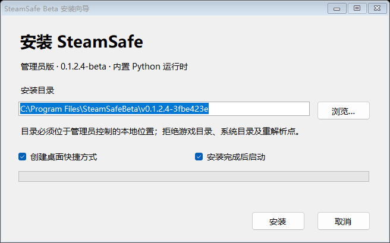
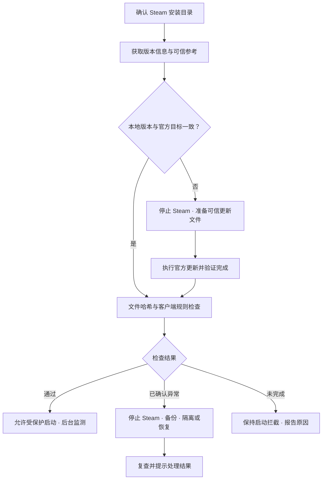

<div align="center">

# SteamSafe

**为 Steam 客户端增加完整性检查、后台监测与异常修复。**


[下载安装包](https://github.com/hoadl114514/SteamSafe/releases/tag/v0.1.2.4-beta) · [使用说明](#快速开始) · [源码构建](#开发与构建) · [反馈问题](https://github.com/hoadl114514/SteamSafe/issues)

</div>

---

SteamSafe 是一个独立的 Windows 桌面工具。它结合官方更新文件的哈希校验与客户端加载路径、配置、界面脚本检查，帮助发现 Steam 客户端篡改；对已确认的异常，先停止 Steam、备份原文件，再尝试隔离或恢复。

程序支持常驻托盘与登录自启，安装包内置 Python 运行时，**使用时无需另行安装 Python**。当前处于 Beta 阶段，不是 Valve 官方产品，也未获 Valve 背书。

## 功能一览

| 功能 | 当前行为 |
| --- | --- |
| 启动前检查 | 通过“校验并启动 Steam”执行检查；高风险证据、可信文件不一致或检查未完成时阻止本次受保护启动 |
| 官方文件校验 | 从官方 HTTPS 更新 CDN 获取版本清单与验证组件，比对关键程序及界面文件 |
| 客户端异常检查 | 检查敏感加载目录、DLL 侧载线索、配置、客服路由、假告警及脚本加载关系 |
| 后台监测 | 接收文件变化通知，独立线程约每 0.5 秒检查进程状态；网络下载不阻塞该线程 |
| 隔离与恢复 | 对已确认、受规则覆盖的异常保留备份，隔离新增恶意脚本或恢复可信文件，随后复查 |
| 版本感知更新 | 发现本地版本与 CDN 不一致后执行官方更新，并主动验证更新是否完成 |
| 复发拦截 | 修复后 5 分钟内再次出现异常时保持拦截，可在处理来源后复查解除 |
| 程序自检 | 固定代码签名证书，验证 Authenticode 与 Ed25519 签署的发行文件清单 |
| 安装与卸载 | 自定义安装目录、可选桌面快捷方式、开始菜单入口及 Windows 应用卸载入口 |

脚本检查也覆盖客服／URL 上下文中的复制拦截、剪贴板替换以及与日期、定时器关联的延迟载荷线索。定时器、陌生域名或未收录文件本身不会自动等同于恶意。

## 快速开始

### 1. 下载并安装

在 [Beta v0.1.2.4 Release](https://github.com/hoadl114514/SteamSafe/releases/tag/v0.1.2.4-beta) 下载：

- `SteamSafe-v0.1.2.4-Beta-Setup.exe`：安装程序。
- `SteamSafe-Uninstall-Repair.exe`：旧 Steam Sentinel／SteamSafe 卸载失败时使用，启动后选择已登记的安装，再点击卸载。修复器必须从安装目录之外运行。
- `SHA256SUMS.txt`：下载文件的 SHA-256 校验和。
- `SteamSafe-v0.1.2.4-Beta-source.zip`：对应发布提交的源码包。

安装包和源码可在上方 GitHub Release 页面下载。

运行安装器并允许 UAC，选择安装目录；桌面快捷方式和安装后启动均可选。默认安装在 Program Files。自定义目录及已有父目录须满足管理员控制要求，网络路径、重解析点、Windows 和游戏数据目录会被拒绝。

<p align="center">
  
</p>

当前使用自签名证书，Windows 可能显示未知发布者或不受信任证书。程序不会自动向系统 Root 或 TrustedPublisher 证书库添加信任。

### 2. 确认 Steam 目录

首次运行先核对自动发现的 Steam 安装目录，再点击 **“立即检查”**。目录尚未确认时，后台守护等待确认，不执行管理员修复。

检查完成后，使用 **“校验并启动 Steam”** 启动客户端。后台守护与自动隔离修复默认启用，也可在界面调整。

> 从 Steam 原有快捷方式或其他入口启动时，SteamSafe 只能事后监测，不能保证在客户端加载之前完成拦截。

### 3. 按需启用自启

勾选 **“登录 Windows 后启动并常驻托盘”**。程序使用最高权限计划任务，任务动作指向受保护安装目录中的 EXE。

当前仅支持同一管理员账号的桌面登录；跨账号 UAC 不支持该自启方式。Steam 和官方帮助浏览器通过桌面用户令牌启动，避免继承守护程序的管理员权限。

## 检查与修复如何工作



### 版本不一致时

版本不同本身不代表感染。SteamSafe 先停止 Steam，为目标版本准备可信参考；如果更新启动器或依赖不可信，先恢复受覆盖文件，再以桌面用户身份执行 `steam.exe -forcesteamupdate`。

更新完成需要同时满足本地目标版本、连续三次稳定文件快照、新启动日志中的目标 `installed version` 与 `Verification complete`，以及最终哈希和安全复查。随后再次请求 CDN，检查更新过程中是否发布了新版本。

默认等待上限为 10 分钟。网络错误、超时、目标再次变化等情况会报告未完成并结束 Steam。窗口出现或下载结束不能单独证明更新完成。

### 发现异常时

对已确认高风险、非官方基线的 `steamui`／`clientui` 新增 JS/MJS，程序先备份再移除；受覆盖的已知程序及 JS/CSS/HTML 从验证组件恢复。游戏目录中的同名 MOD 不进入自动删除范围。无可信恢复来源或无权限修复时，维持拦截并报告。

修复文件不意味着感染来源已清除或账号已经安全。如果恶意代码曾执行，应在可信设备处理密码、会话授权和登录记录。界面提供固定的官方账号安全指引入口。

## v0.1.2.4 后台检测修复

修复缓存更新清单导致可信文件篡改漏拦截，以及变化通知与混合大小写基线文件名匹配失败的问题。后台即时守护在稳定同版本哈希复核不一致时停止 Steam 并安排修复；真实受控更新仍使用更新状态区分。新增后台就绪状态及初始化失败日志。详见 [后台检测修复验收](QA-background-v0.1.2.4.md)。

## v0.1.2.3 卸载修复

修复未创建自启任务时卸载出现 `0x80070002` 的问题：Windows 会将缺失任务映射为 `FileNotFoundException`，现在按缺失资源处理。快捷方式或发行文件已移除时可继续卸载；权限错误仍会报错。发行清单在删除前完整验证，失败对话框显示具体步骤和错误码。

旧版本报错时，从本版 Release 下载 `SteamSafe-Uninstall-Repair.exe`，在下载目录运行，选择对应的 Steam Sentinel 或 SteamSafe 安装。默认保留隔离备份。仅重新安装新版不会替换旧安装目录里的卸载器。

## 升级、数据与卸载

**升级：**先关闭旧版自启并从托盘退出，再安装新版、重新检查并设置自启。从旧名称 Steam Sentinel 升级时，SteamSafe 使用独立的数据目录与任务；旧版备份不会自动迁移或删除。

程序数据位于 `%ProgramData%\SteamSafeBeta-v0.1.2`，只允许管理员和 SYSTEM 访问。隔离原文件保存在 `quarantine/old`，修复记录保存在 `journal.json`。回滚须退出 Steam，且可能恢复危险文件。

**卸载：**从 Windows“已安装的应用”、开始菜单卸载入口或安装目录中的 `Uninstall.exe` 启动。卸载移除本版本的守护程序、匹配的自启任务、快捷方式、登记和发行文件，不删除 Steam、游戏或存档。

默认保留设置、缓存和隔离备份。删除共享数据需要勾选并再次确认；登记有其他版本时禁止清理。正在运行的卸载器及最终空目录在重启后清除，重启前不能复用该安装目录。

## 支持范围与安全边界

| 项目 | 当前支持情况 |
| --- | --- |
| 系统与客户端 | Windows 10/11 x64，Steam 正式版 |
| 尚未支持的恢复目标 | Win32、ARM64、Steam Beta、Steam China |
| 离线检查 | 可使用匹配的签名发行基线；不能确认是否为最新版本 |
| 内存与进程注入 | 没有内核防注入驱动、PPL 或完整内存保护；不能保证阻断无文件注入、手动映射及凭据读取 |
| 脚本检测 | 有大小、数量和规则覆盖限制，复杂混淆与运行时生成代码可能漏检 |
| 自身保护 | 可检测发行文件篡改，不提供抵御同等管理员或内核权限攻击者的可靠隔离 |

未收录的编号脚本只记录为信息，仍接受语义检查；不因“官方基线之外”这一项单独阻止启动。主动安装的客户端插件可能触发严格规则。

若系统已配置 Sysmon，程序可读取近 5 分钟的 FileCreate／ProcessAccess 元数据辅助归因；不安装 Sysmon，也不会仅凭这些线索删除外部游戏或 MOD。

## 隐私

运行时联网仅请求官方更新 CDN，不上传文件、账号或扫描报告，不搜集账号令牌。URL 证据隐藏查询参数。

日志与隔离文件保存在本地受保护目录，可能包含本地路径和原恶意内容。提交问题或分享导出报告前，请核对其中的信息。

## 开发与构建

需要 Windows x64、Python 3.12、.NET Framework 4.8 和 Windows SDK SignTool。构建脚本当前使用 Windows SDK `10.0.26100.0` 的默认 SignTool 路径；其他 SDK 版本需调整 [`tools/sign_release.ps1`](tools/sign_release.ps1)。

```powershell
git clone https://github.com/hoadl114514/SteamSafe.git
cd SteamSafe
py -3.12 -m venv .venv
.\.venv\Scripts\python.exe -m pip install -r requirements-build.txt

# 运行源代码安全回归测试
.\.venv\Scripts\python.exe -m tests.test_security

# 首次构建：拉取官方基线并生成自己的签名密钥
.\build.ps1 -RefreshBaseline

# 后续使用已有私钥构建
.\build.ps1
```

首次刷新基线需要访问官方更新 CDN。输出安装器位于 `dist/SteamSafe-v0.1.2.4-Beta-Setup.exe`。

发行者的私钥没有上传到仓库。从源码构建会生成自己的 Ed25519 密钥和自签名代码签名证书；不能复用发行者签名。`.release-keys/` 中的私钥、PFX 和口令必须保密，不应进入 Git、安装包或源码包。

| 目录 | 内容 |
| --- | --- |
| `main.py` | 桌面界面与托盘入口 |
| `sentinel/` | 校验、规则检查、守护、更新及 Windows 权限处理 |
| `tools/` | 基线生成、构建签名、安装卸载与发行验证 |
| `tests/` | 安全回归测试 |
| `assets/` | 图标、公钥、签名证书及发行基线 |
| `licenses/` | 第三方许可证与元数据 |

## 验证与反馈

当前版本通过 74 项安全回归、21 项原生卸载回归、7 项安装路径约束检查、打包后诊断副本的界面启动及发行签名检查。真实 UAC 安装、系统登记、计划任务注册和卸载写入流程仍需在受控 Windows 机器验收。详见 [卸载修复验收](QA-uninstall-v0.1.2.3.md) 和 [此前安装器验收范围](QA-installer-v0.1.2.2.md)。

在 [Issues](https://github.com/hoadl114514/SteamSafe/issues) 反馈时，请附 Windows 版本、Steam 正式版版本、SteamSafe 版本、复现步骤及脱敏日志。误报反馈请说明是否使用客户端插件或修改配置。

## 许可证与致谢

项目采用 [Apache-2.0](LICENSE)。Python、Qt／PySide6 等依赖遵循各自许可证，详见 [第三方声明](THIRD-PARTY-NOTICES.md) 和 [`licenses/`](licenses/)。

客户端检测方向参考了 [fenglinbei / IsMySteamSafe](https://github.com/fenglinbei/IsMySteamSafe)，相关检查以 Python 独立实现。Steam 是 Valve 的商标，本项目与 Valve 无隶属关系。
